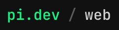
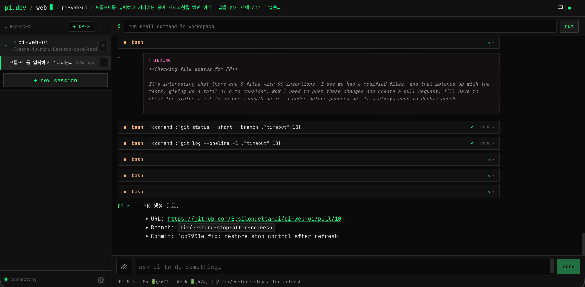
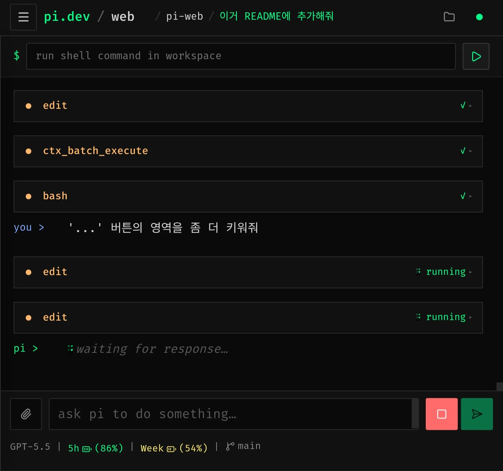
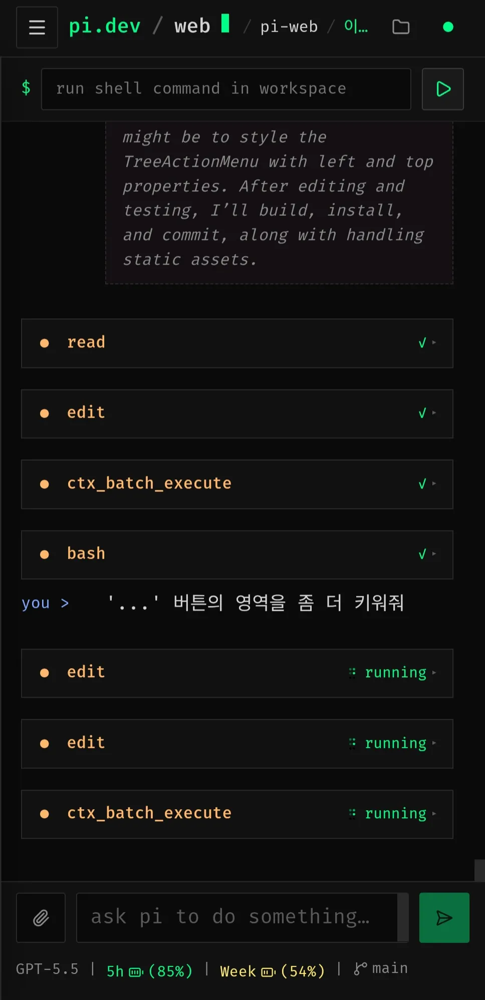

<h1 align="center">pi-web</h1>

<div align="center">



| Desktop |
| --- |
|  |

| Tablet | Mobile |
| --- | --- |
|  |  |

</div>

## Installation

Install the latest GitHub release binary:

```bash
curl -fsSL https://raw.githubusercontent.com/Epsilondelta-ai/pi-web/main/scripts/install.sh | sh
```

Run after installation:

```bash
pi-web
# Listens on 0.0.0.0:8732. Open http://127.0.0.1:8732

pi-web --port 9999
# Open http://127.0.0.1:9999
```

## Introduction

A web UI for viewing and controlling the local `pi` coding agent in your browser.
It bundles an Astro-based frontend and a Go backend into a single executable, so you can run the workspace/session UI in a local browser without configuring a separate server.

## User-level configuration

pi-web stores the brand setting in the user-level `pi-web-config.json` file. The default path is `~/.pi/agent/pi-web-config.json`; with a custom session directory, it is `<parent of PI_CODING_AGENT_SESSION_DIR>/pi-web-config.json`. To reset the brand, delete `pi-web-config.json`; pi-web will use the default brand.

This brand setting does not use pi native `settings.json` or `auth.json`, project `.pi` files, browser storage, or SQLite.

To restrict selectable workspaces, add `allowedRoots` to `pi-web-config.json`:

```json
"workspace": {
  "allowedRoots": ["~/code", "/workspaces"]
}
```

When `allowedRoots` is missing or an empty array, workspace access is unrestricted. When it is non-empty, every root must resolve to a real, existing directory. Workspace paths that escape an allowed root through a symlink are rejected. Historical workspaces outside the configured roots are hidden and rejected. Deleting `pi-web-config.json` restores the default unrestricted workspace behavior.

On the first launch, pi-web opens a login page where the administrator creates the `admin` password. Accounts are stored as salted hashes in `pi-web-users.json` beside the app config, and browser sessions use HttpOnly cookies. Administrators can create users and assign existing workspaces at `/users`; users can only see their assigned workspaces and their own sessions, and cannot open or clone workspaces. Changing the brand, allowed workspace directories, provider credentials, or global settings remains administrator-only. This is application-level authorization, not an OS/container sandbox: shell commands still run with the server process permissions.

## Features

- **Workspace management**: Administrators open local folders and clone repositories; users receive only assigned workspaces.
- **User and session isolation**: Manage accounts, assign workspaces, and isolate session ownership with HttpOnly login sessions.
- **Session UI**: Browse existing pi sessions, create new sessions, and stream prompts/responses in real time.
- **File browsing and preview**: Browse the workspace file tree, read files, edit them, and save changes from the UI.
- **Local command execution**: Run shell commands in the selected workspace.
- **Single executable**: Distribute the Astro static build embedded in a Go binary.
